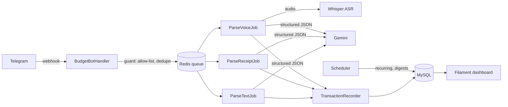

# 🤖 AI Family Budget Bot

[](https://github.com/RuslanBaatyrbekov/budget-bot/actions/workflows/tests.yml)


A family finance tracker my wife and I use every day. Nobody wants to type expenses into a spreadsheet, so you just **send the bot a receipt photo, a voice note or a line of text** — Gemini turns it into categorized transactions, and a Filament dashboard shows where the money goes.

| Telegram bot | Web dashboard |
| :---: | :---: |
|  |  |

## ✨ Features

**Input**
- ✍️ **Text** — `coffee 3.50`, `yesterday REWE 42 by card`, several purchases in one message
- 📸 **Receipt photos and PDFs** — every line item becomes a transaction; discounts and Pfand returns are handled as negative items; the photo is kept and visible in the dashboard
- 🎙 **Voice messages** — transcribed locally by Whisper (no audio leaves your server), then parsed like text
- 💰 **Income** — `salary 2500` is recognized as income, reports show the monthly balance

**Budgeting**
- 🎯 **Monthly limits** per category or in total, with a warning at 80 % and 100 %
- 🔁 **Recurring payments** (rent, phone, insurance) booked automatically on their day
- 🗓 **Weekly digest** every Sunday and a **monthly summary** on the 1st
- 👨‍👩‍👧 **Shared wallets** — invite your partner with a one-time code, reports show who spent what

**Reports and data**
- 📊 `/report` by category, payment method and person, compared with the previous month
- 🏪 `/stores` — spending per shop
- 📤 `/export` — month as CSV (opens in Excel)
- 🖥 Filament dashboard: trends, categories, limits, stores, weekdays, top purchases; edit records, merge duplicate categories

**Security**
- Allow-list of Telegram IDs (empty list = nobody), optional webhook secret
- Every button checks that the record belongs to your wallet
- Invite codes are random, single-use and expire after 48 h
- Passwordless web login through a one-time signed link from `/web`

## 🧭 How it works



The webhook only validates the update and queues a job, so Telegram gets an answer immediately. Jobs ask Gemini for **schema-constrained JSON** (`responseSchema`), store all items of a message in one DB transaction and retry with back-off on rate limits.

## 💬 Bot commands

| Command | What it does |
| --- | --- |
| `/start` | Create your profile and wallet with default categories |
| `/report` | Monthly report with ◀️ ▶️ month navigation |
| `/stores` | Spending per shop |
| `/limits`, `/limit Groceries 400` | Show / set monthly limits (`/limit 2000` for everything, `0` removes) |
| `/regular`, `/regular 850 Rent 1` | List / add recurring payments (amount, description, day of month) |
| `/export`, `/export 2026-10` | CSV export of a month |
| `/undo` | Delete your last record (whole receipt if it was one) |
| `/invite`, `/join CODE` | Share the wallet with your family |
| `/currency` | Wallet currency |
| `/web` | One-time login link to the dashboard |

## 🛠 Tech stack

- **Backend:** PHP 8.4+, Laravel 13, queues on Redis, scheduler
- **Bot:** [defstudio/telegraph](https://github.com/defstudio/telegraph)
- **AI:** Google Gemini (text and vision), [Whisper ASR webservice](https://github.com/ahmetoner/whisper-asr-webservice) (faster-whisper, runs locally)
- **Dashboard:** Filament 3, Chart.js, laravel-trend
- **Infrastructure:** Docker Compose (Laravel Sail), MySQL 8.4, ngrok
- **Quality:** PHPUnit feature tests with HTTP/queue/Telegram fakes, Pint, GitHub Actions

## 🚀 Setup

**1. Clone and install**

```bash
git clone https://github.com/RuslanBaatyrbekov/budget-bot.git
cd budget-bot
composer install
cp .env.example .env
php artisan key:generate
```

**2. Fill in `.env`**

| Variable | Where to get it |
| --- | --- |
| `GEMINI_API_KEY` | [Google AI Studio](https://aistudio.google.com/apikey) |
| `ALLOWED_TELEGRAM_USERS` | Your Telegram IDs, comma separated. The bot replies with your ID if you are not on the list |
| `TELEGRAPH_WEBHOOK_SECRET` | Any random string |
| `NGROK_AUTHTOKEN`, `NGROK_DOMAIN` | [ngrok dashboard](https://dashboard.ngrok.com) (a free static domain is enough) |
| `APP_URL` | `https://<your NGROK_DOMAIN>` |

**3. Start the containers**

```bash
./vendor/bin/sail up -d          # app, worker, scheduler, mysql, redis, whisper, ngrok
./vendor/bin/sail artisan migrate
./vendor/bin/sail artisan storage:link
```

**4. Connect the bot** (create it with [@BotFather](https://t.me/BotFather) first)

```bash
./vendor/bin/sail artisan telegraph:new-bot      # paste the token, answer "yes" to set up the webhook
./vendor/bin/sail artisan bot:setup-commands     # command menu in Telegram
```

Send `/start` to your bot — done. Open the dashboard with `/web`.

Changed `APP_URL` or `TELEGRAPH_WEBHOOK_SECRET` later? Run `sail artisan telegraph:set-webhook` again.

## 🧪 Tests

```bash
./vendor/bin/sail artisan test
./vendor/bin/sail pint --test
```

Gemini, Whisper and the Telegram API are faked, so tests run offline. They cover parsing (cents precision, income, discounts, rate limits), webhook access rules and duplicate updates, invites, ownership checks on buttons, limits and alerts, recurring payments, exports, digests and data isolation in the dashboard.

## 📁 Project structure

```
app/
├── Webhooks/BudgetBotHandler.php   # commands and inline buttons
├── Jobs/                           # ParseText / ParseReceipt / ParseVoice (+ shared base job)
├── Services/
│   ├── Ai/                         # GeminiClient, ExpenseParser (prompts + JSON schema)
│   ├── TransactionRecorder.php     # atomic save + category matching
│   ├── ReportService.php           # monthly / period aggregates
│   ├── BudgetService.php           # limits and alerts
│   ├── RecurringPaymentService.php
│   ├── WalletService.php           # wallets and invites
│   └── CsvExporter.php
├── Telegram/                       # message texts, keyboards, file download
├── Console/Commands/               # budget:recurring, budget:digest, bot:setup-commands
└── Filament/Admin/                 # dashboard, resources, widgets
```

## 🗺 Roadmap

- [ ] Telegram Mini App instead of the web panel on phones
- [ ] Bank CSV import (Sparkasse, N26, DKB)
- [ ] Questions in plain language: “how much did we spend on delivery in October?”
- [ ] Savings goals
- [ ] Multi-currency wallets with conversion

## 📄 License

[MIT](LICENSE)
